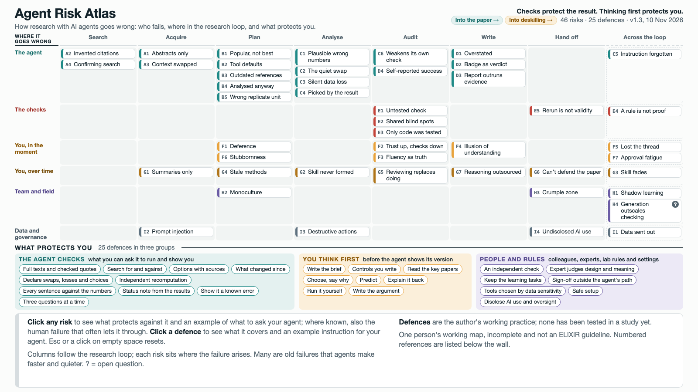

# Agent Risk Atlas

How research with AI agents goes wrong: who fails, at which step, and what protects you.

**[Open the atlas](https://michalie.github.io/agent-risk-atlas/)** · **[Read the essay](https://michalie.github.io/agent-risk-atlas/essay.html)** · [How errors reach print](https://michalie.github.io/agent-risk-atlas/paths.html#paper) · [How judgement erodes](https://michalie.github.io/agent-risk-atlas/paths.html#deskill)



If you use AI agents in your research, or are about to, this is for you. Agents can save you weeks of work, but their errors read as well as facts, and they tend to slip through in the same few ways. The atlas puts those ways on one screen, together with what you can do about each one.

I made it for an ELIXIR hands-on training session on AI agents in life-science research. Project it to start a discussion with your group, or explore it on your own.

Related: [Publishing Under AI](https://michalie.github.io/publishing-under-ai/): how scientific writing and peer review are coping with AI, where researchers disagree, and what is being tried · [What journals actually require](https://michalie.github.io/journal-ai-policies/): what publishers say about generative AI.

## How to read it

Each box is one risk. The rows show who fails: the agent, the checks around it, you in the moment, you over time, your team and field, and data governance. The columns follow a research project, from searching the literature to handing the work on.

Click a risk to see what protects you against it, and an example of what you could ask your agent. For some risks you will also see the human failure that often lets the agent's error through.

The defences come in three groups:

- **The agent checks:** things you can ask the agent to run and show you.
- **You think first:** thinking only you can do, before the agent shows its version.
- **People and rules:** colleagues, experts, lab rules and settings.

The example requests are written in plain words, so adapt them to your own work. They and the defences come from my own practice; none of them has been tested in a study yet. Three ideas behind them have support from experiments in other settings: adding a step before the AI's answer is shown, so that people follow wrong answers less often ([Buçinca et al. 2021](https://doi.org/10.1145/3449287)); making that answer quick to check ([Vasconcelos et al. 2023](https://doi.org/10.1145/3579605)); and keeping a real share of the creative work with the person: by their own timing writers took no longer, they reported higher satisfaction, and their stories were less uniform than when they only approved the AI's work ([Hosanagar & Ahn 2026](https://doi.org/10.1093/pnasnexus/pgag353)).

## Finding your way

Click a risk or a defence to highlight it. Press Esc or click on empty space to clear it, and use the arrow keys to move from risk to risk. You can also link to a single risk, for example [#B5](https://michalie.github.io/agent-risk-atlas/#B5).

An [introductory essay](https://michalie.github.io/agent-risk-atlas/essay.html) walks through the main argument and five practical habits in ~10 minutes. A standalone companion page follows seven example errors through checks and peer review [into print](https://michalie.github.io/agent-risk-atlas/paths.html#paper), and five skill tracks [into deskilling](https://michalie.github.io/agent-risk-atlas/paths.html#deskill), as you switch on the groups of defences.

## Where the content comes from

When you click a risk, its description shows numbered references to the list under the wall. Each reference is marked as a published source, my own observation, or my proposal. I checked the published sources against Crossref, arXiv or the publisher in November 2026.

This is my working map, not an official ELIXIR document. It is about honest mistakes; misconduct is out of scope.

## Seen a risk that isn't here?

Please tell me. [Open an issue](https://github.com/MichaLie/agent-risk-atlas/issues/new) and describe what happened, or what you think could happen. Cases from your own work help most. Issues are public, so leave out anything confidential.

## How it was made

I drafted the atlas with AI agents (Claude, by Anthropic), then checked and edited it myself. Three of the cited works have authors at Anthropic: the study on analysts following an agent's suggestions (F1, G7), the study on skill formation (G2) and ImpossibleBench (C6).

## Reusing or changing it

You are welcome to reuse and adapt it under the licence below. The content is in `data/` as plain YAML files. `build.py` checks them and writes the pages into `docs/`:

```
pip install -r requirements.txt
python3 build.py
```

Risk IDs stay fixed from version 1.0. If a risk is removed, its ID is not reused.

## Citing

Liegertová M. *Agent Risk Atlas*, version 1.7. 2026. https://github.com/MichaLie/agent-risk-atlas

## Licence

Text and data: CC BY 4.0 (see `LICENSE-content.md`). Code: MIT (see `LICENSE`).
